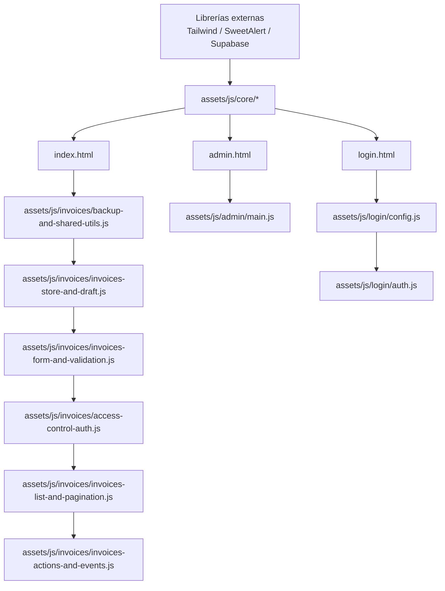

# Sistema de Facturación Electrónica / Electronic Billing System

Aplicación web para gestión de facturas con autenticación en Supabase y panel de administración de usuarios.

Web app for invoice management with Supabase authentication and an admin user panel.

## URL pública / Public URL

- Despliegue principal / Main deploy: **Vercel**.
- Vercel es necesario para la gestión de usuarios (función serverless `api/users.js`).
- Vercel is required for user management (serverless function `api/users.js`).

Rutas limpias (gracias a `cleanUrls` en `vercel.json`):

- Sitio / Site: `/`
- Login: `/login`
- Admin: `/admin`
- Historial: `/historial`

> Las rutas limpias (`/login`, `/admin`, `/historial`) funcionan en Vercel. Un hosting puramente estático como GitHub Pages no las resuelve ni ejecuta `api/`.

## Licencia / License

- Este proyecto está publicado bajo **GNU General Public License v2.0** (GPL-2.0-only).
- This project is distributed under **GNU General Public License v2.0** (GPL-2.0-only).
- Ver texto completo en `LICENSE`.
- Resumen práctico en `docs/LICENCIA_RESUMEN.md`.

## Estructura del proyecto / Project Structure

```text
.
├── index.html
├── login.html
├── admin.html
├── historial.html
├── LICENSE
├── README.md
├── package.json
├── sw.js
├── vercel.json
├── api/
│   └── users.js
├── assets/
│   ├── css/
│   │   └── app.css
│   ├── js/
│   │   ├── admin/
│   │   │   └── main.js
│   │   ├── core/
│   │   │   ├── supabase-config.js
│   │   │   ├── supabase-client.js
│   │   │   ├── supabase-utils.js
│   │   │   ├── list-utils.js
│   │   │   ├── html-utils.js
│   │   │   ├── loading-utils.js
│   │   │   ├── password-utils.js
│   │   │   ├── performance-utils.js
│   │   │   ├── session-utils.js
│   │   │   ├── status-utils.js
│   │   │   ├── sw-register.js
│   │   │   ├── theme-utils.js
│   │   │   └── toast-utils.js
│   │   ├── invoices/
│   │   │   ├── access-control-auth.js
│   │   │   ├── backup-and-shared-utils.js
│   │   │   ├── invoices-actions-and-events.js
│   │   │   ├── invoices-form-and-validation.js
│   │   │   ├── invoices-list-and-pagination.js
│   │   │   └── invoices-store-and-draft.js
│   │   └── login/
│   │       ├── auth.js
│   │       └── config.js
│   └── external/
│       ├── files/
│       ├── images/
│       └── videos/
├── docs/
│   ├── CHECKLIST_REFACTOR_ADMIN_SEGURO.md
│   ├── CONVENCION_MODULOS_JS.md
│   ├── INSTRUCCIONES_SUPABASE.md
│   └── LICENCIA_RESUMEN.md
├── supabase/
│   └── migrations/
│       └── 0001_init.sql
└── templates/
    ├── plantilla-base.html
    └── plantilla-formulario.html
```

## Notas / Notes

- Las páginas viven en la raíz (`index.html`, `login.html`, `admin.html`, `historial.html`) y se sirven con rutas limpias (`/`, `/login`, `/admin`, `/historial`).
- The pages live at the project root and are served with clean URLs.
- Los assets se referencian de forma relativa a la raíz (`assets/...`).
- Para recursos multimedia nuevos, usa `assets/external/`.
- For new media resources, use `assets/external/`.
- Documentación Supabase / Supabase docs: `docs/INSTRUCCIONES_SUPABASE.md`.
- Convención de módulos JS / JS module conventions: `docs/CONVENCION_MODULOS_JS.md`.

## Reglas rápidas de módulos JS / Quick JS module rules

1. Separar por **funcionalidad** (auth, render, eventos, validación, backup), no por tamaño arbitrario.
2. Cargar scripts en orden de dependencia: librerías externas → `assets/js/core/*` → módulos de página.
3. Usar nombres descriptivos con guiones (ejemplo: `invoices-form-and-validation.js`).
4. Evitar scripts inline grandes en HTML; mover lógica a `assets/js/<pagina>/`.
5. Cuando haya estado compartido, centralizarlo en un objeto global por página (ejemplo: `window.adminState`).

## Rendimiento / Performance

- Skeleton screens activos en listados de facturas y usuarios durante carga inicial.
- Lazy loading listo para multimedia diferida (`data-src`, `data-srcset`, `data-poster`, `data-bg-src`) en `assets/js/core/performance-utils.js`.
- Caché de navegador con Service Worker (`sw.js`) y registro automático en `assets/js/core/sw-register.js`.
- Recomendación para recursos pesados: convertir imágenes a WebP y evitar widgets/scripts no esenciales.

### Flujo de carga de scripts (Mermaid)



## Ejecutar localmente / Run Locally

### Opción 1: Live Server (VS Code)

- Abre `index.html` y selecciona **Open with Live Server**.
- Open `index.html` and select **Open with Live Server**.

### Opción 2: Python HTTP Server

1. En la raíz del proyecto, ejecuta / From the project root, run:

```bash
python -m http.server 5500
```

1. Abre en el navegador / Open in your browser:

- `http://localhost:5500/`
- `http://localhost:5500/login.html`
- `http://localhost:5500/admin.html`

> Nota: las rutas limpias (`/login`, `/admin`) solo las resuelve Vercel (`cleanUrls`). En local usa los `.html`.

## Instalar librerías (CDN) / Install libraries (CDN)

Este proyecto es HTML/CSS/JS estático (sin build en el frontend), así que la forma más simple es usar CDN.

This project is static HTML/CSS/JS (no frontend build), so the easiest approach is using a CDN.

- Agrega el script en el `<head>` de `index.html` (o en la página donde lo usarás).
- Usa la librería desde `window` en tu JavaScript.

- Add the script in the `<head>` of `index.html` (or the specific page where it is used).
- Use the library from `window` in your JavaScript.

Ejemplo / Example (Supabase, ya integrado como módulo ESM):

```js
import { createClient } from 'https://cdn.jsdelivr.net/npm/@supabase/supabase-js@2/+esm';
```

> El `package.json` de la raíz solo existe para la función serverless (`api/users.js`); el frontend no usa build.

### Librerías recomendadas (CDN) / Recommended libraries (CDN)

| Librería / Library | Úsala para / Use it for | CDN (pegar en head) |
| --- | --- | --- |
| Chart.js | Gráficas de ventas, pagadas vs pendientes, reportes / Sales charts, paid vs pending, reports | `<script src="https://cdn.jsdelivr.net/npm/chart.js"></script>` |
| IMask | Máscaras de input para dinero, NIT, teléfono / Input masks for currency, tax ID, phone | `<script src="https://cdn.jsdelivr.net/npm/imask"></script>` |

## Respaldo manual / Manual backup

- Usa **Exportar** para descargar una copia JSON de las facturas.
- Usa **Importar** para restaurar una copia JSON (reemplaza el dataset actual).
- La app muestra un recordatorio para hacer respaldo manual; no crea copias automáticamente.
- Los respaldos se exportan **cifrados con clave** para proteger datos sensibles.
- **No pierdas la clave del respaldo**: sin esa clave no se puede descifrar ni importar la copia.

## Checklist de publicación / Pre-release checklist

- Verificar login y redirección sin sesión (`/login`).
- Probar crear, editar, eliminar y deshacer eliminación de facturas.
- Confirmar exportación/importación de respaldo manual.
- Validar PDF (previsualización y descarga).
- Revisar vista activa e historial pagadas.
- Confirmar migración y políticas RLS aplicadas en Supabase (`docs/INSTRUCCIONES_SUPABASE.md`).